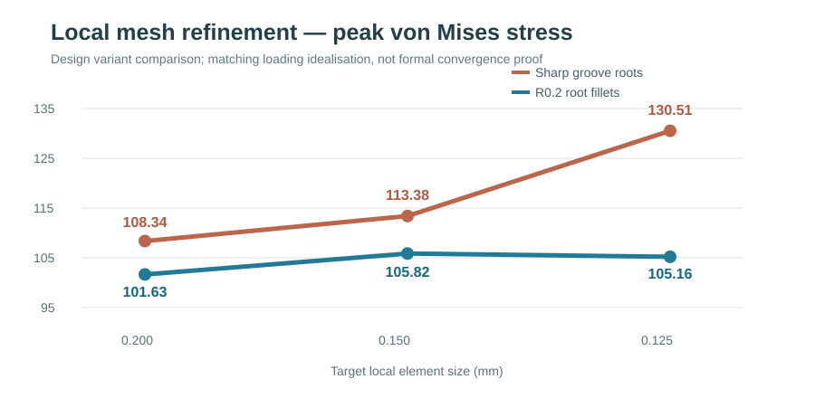

# Planetary Gearbox — Planet Carrier CAD & Static FEA
**Technical case study / November 2026 — Reza Babapiri**

> **Status:** Preliminary self-directed digital CAD and simulation study. Not physically fabricated, independently tested, certified or released for manufacture. Values below are taken from the author's recorded SOLIDWORKS and ANSYS evidence, not independently recomputed by a new solver run.

## Design question
Does replacing sharp internal groove-root corners with approximately **R0.2 mm** fillets improve the local finite-element stress response of a planet-carrier output shaft? This case is a component-level investigation supporting a wider digital planetary gearbox assembly.

## CAD evidence
An original approximately 3-second SOLIDWORKS exploded assembly AVI shows the digital gearset and surrounding components. It is evidence of assembly presentation, not gear-tooth contact verification, drivetrain efficiency, assembly tolerances or physical manufacturability. The source carrier STEP shows a circular flange, three planet-pin holes and an output shaft with a longitudinal slot. Prior model inspection recorded nominal larger shaft Ø17 mm, end shaft Ø15 mm and groove root Ø12 mm, with a narrow bottom section approximately 1 mm wide. These are observed model dimensions, not production tolerances.

**Revision:** Two internal groove-root corners in the initial STEP geometry were sharp, even though visible external lips had approximately R0.5 mm rounding. The revised STEP model adds approximately R0.2 mm internal fillets. Groove function and fit (e.g. a retaining feature) must be checked before using this geometry in a physical design.

## Analysis setup
- **Solver:** ANSYS Mechanical 2025 R2 Student; Static Structural.
- **Material:** generic Structural Steel (E = 200 GPa; ν = 0.30; density = 7850 kg/m³; yield strength = 250 MPa). Specific production grade is unknown.
- **Support:** idealized Cylindrical Support on selected larger-shaft cylindrical surfaces. This simplifies real bearing/support compliance.
- **Torque:** +8180 N·mm about the global Y axis.
- **Planet bearing loads:** distributed Bearing Loads scoped to corresponding cylindrical pin-hole surfaces.

| Entered bearing | Fx [N] | Fy [N] | Fz [N] |
|---|---:|---:|---:|
| A | −60.591 | 0 | −104.948 |
| B | −60.591 | 0 | +104.948 |
| C | +121.185 | 0 | 0 |

Nominal entered-force resultant: approximately +0.003 N in X. Numerically integrated Bearing Load transfer can differ from the entered vector because the curved face is discretized.

## Local mesh sensitivity
Quadratic tetrahedral elements (Tet10) were used with local groove edge/face refinements.

| Groove variant | Nominal target local size [mm] | Recorded peak von Mises [MPa] |
|---|---:|---:|
| Sharp internal root | 0.200 | 108.34 |
| Sharp internal root | 0.150 | 113.38 |
| Sharp internal root | 0.125 | 130.51 |
| R0.2 fillet at root | 0.200 | 101.63 |
| R0.2 fillet at root | 0.150 | 105.82 |
| R0.2 fillet at root | 0.125 | 105.16 |
| R0.2 + additional Planet B bore refinement | 0.125 | **105.40** |

The final bore-refined mesh had **91,834 nodes**, **54,860 Tet10 elements** and an average ANSYS Element Quality of **0.69311** (minimum **0.096109**, maximum **0.99993**). The revised last two groove sizes differed in peak stress by approximately **0.62%**, while adding the bore refinement changed the result by roughly **0.23%**. These trends support preliminary stability but are insufficient for definitive mesh independence. The original sharp-root peak increased significantly as the mesh was refined.

The apparent difference between the old 0.125 mm result (130.51 MPa) and final revised result (105.40 MPa) is about **19.2%**. This is an observed change across geometry/mesh variants, **not** a rigorously isolated, validated fillet benefit. Matched mesh techniques, integrated load results, local quality reviews and additional refinements would be required to quantify that claim robustly.

## Recorded final full-loading solution
| Metric | Recorded value |
|---|---:|
| Maximum equivalent (von Mises) stress | **105.40 MPa** |
| Maximum total displacement | **0.0063473 mm** (6.35 μm) |
| Generic yield strength used | **250 MPa** |
| Nominal elastic yield-stress ratio | **2.37** |
| Combined cylindrical-support force reaction | **0.68293 N** |
| Combined support reaction moment My | **−8187.2 N·mm** |

The highest stress occurs at the groove/shaft shoulder region; maximum displacement is near the free end of the shaft. The 2.37 result is strictly **250 / 105.40** and is not a validated service factor of safety.

## Bearing load and equilibrium checks
With the global applied moment and the other two bearings temporarily suppressed, the individual bearing reactions were:
- Planet A: approximately 121.18 N, consistent with the entered nominal vector.
- Planet B: initially 119.22 N against approximately 121.18 N entered, a 1.62% discrepancy in magnitude.
- Planet C: approximately 121.19 N, consistent with the entered nominal vector.
- Planet B after local bore refinement: 121.87 N, discrepancy about 0.57%.

The complete-load reaction magnitude then reduced from approximately 1.9637 N to **0.68293 N**. This suggests sensitivity of numerically distributed Bearing Load integration to bore meshing. The support My of −8187.2 N·mm is close in magnitude to the +8180 N·mm applied torque, but the applied bearing forces also generate moments about the chosen reference point; those must be included in an actual moment-equilibrium check. A complete reaction audit must compare integrated applied nodal forces, all couples and support reactions consistently.

## Engineering limitations and next steps
This model excludes actual gear-tooth contact, tooth-force derivation, misalignment, bearing compliance and contact, pin-hole contact, material certification/heat treatment, plasticity, fatigue, shock, tolerances and physical tests. The lowest element-quality region should be located and inspected. A full design validation would require more mesh levels with a matched strategy, a consistent force/moment audit, analytical section/notch estimates, realistic support constraints, fatigue assessment and prototype correlation. The SOLIDWORKS exploded animation documents a digital assembly, not a working transmission.

**Evidence provenance:** original SOLIDWORKS AVI; two carrier STEP exports; author-captured ANSYS stress, displacement, mesh and reaction screenshots. The companion report and media pack were prepared separately. On this page the cover is a labelled conceptual vector diagram and the chart is a transcription of the author's results, not a source CAD render.

**Software:** SOLIDWORKS; ANSYS Mechanical 2025 R2 Student.

[Open the complete illustrated case study](../projects/planetary-gearbox.html).
